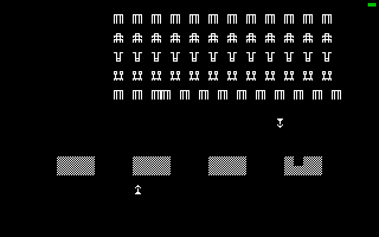

# ACE ST

Jupiter Ace emulator for the Atari ST, written in 68000 assembly (vasm, Motorola syntax).
Licence: GPL v2 or later (see `LICENSE`). Derived in part from xAce (Edward Patel; keyboard
matrix by Lawrence Woodman; Z80 semantics via xz81/xz80 by Russell Marks and Ian Collier).
The keyboard picture shown by the Help key is from EightyOne by Michael D Wynne (GPL v2 or
later, see `assets/README.md`). The Jupiter Ace ROM (`ACE.ROM`) is included, as in xAce; it
is not under the GPL, see `ROM.md`.

The Jupiter ACE is an 8-bit computer most notable for its use of Forth as a built-in
language.



## Status (2026-11-05)

Assembles with vasm and runs in Hatari (ST mono, TOS 1.04). Boots to the Ace prompt, Forth
works (VLIST, arithmetic), and Ace Invaders loads from its .TAP (renamed TAPE.ACE: xAce's block
format is the same as .TAP) and plays.

- **Correctness:** checked against xAce's own Z80 core (`test/oracle`): boot (3M instructions)
  and in-game windows (150k instructions after 1.09M and 3M, with tape loading, typed keys and
  key chords before them) match register for register; registers also match at every
  interrupt before the window. Memory matches except undocumented bits of pushed flags.
- **Speed: about 56% of a real Ace** on an 8 MHz ST, in Ace Invaders (about 819 ACE-ST steps per
  frame, ~45 Z80 T-states each). Steps: ROM code ~15%, native keyboard scan ~19-21%, native
  Forth NEXT ~30%, native data stack ~37%, inline 1K RAM writes ~41%, leaner data stack ~45%,
  screen refresh only when video RAM changed, four cells per compare ~48%, leaner Forth
  NEXT ~50%, handler slots instead of a dispatch table ~52%, byte moves through the stack
  instead of 8-bit shifts and `JP (IY)` straight into `forth_next` ~56%.
  Far from the 70-80% target.
- **Native keyboard scan:** `ED FE C9` at 0x0336 replaces the ROM routine (85 Z80 instructions,
  640 T-states per call; the game calls it about 3.7 times per frame) with 68000 code that
  returns the same registers and flags. `-DNOKBSCAN` keeps the ROM routine, for comparisons.
- **Native Forth NEXT:** every Forth primitive ends with `JP (IY)` to 0x04C8, which checks the
  data stack and free memory, tests BREAK (Shift+Space) and falls into NEXT at 0x04B9: about 36
  Z80 instructions (360 T-states). `ED FF` at 0x04C8 does all of it in one step and leaves the
  same registers, flags and stack bytes. When a check fails it runs only `LD BC,11` and goes on
  in the ROM, which then reports ERROR 1/2/3 itself. `-DNOFNEXT` keeps the ROM code. The usual
  case (dictionary pointer below 0xFFF5, even Z80 SP) uses word compares and word stack
  accesses; the other cases keep exact byte code.
- **Native data stack:** the ROM's Forth data stack routines (pointer at 0x3C3B) run as one step:
  `RST 10` (push DE, 9 Z80 instructions) and `RST 18` (pop DE) are native opcode handlers, as
  0x0010/0x0018 are ROM; `ED FB` at 0x084E pops BC (7). Same registers, memory and stack bytes.
  The new pointer goes straight to 0x3C3B and its three 1K RAM mirrors; a push writes plain
  RAM (0x4000 up) directly, or the 1K RAM and its mirrors through one address register; only
  pushes into ROM/video RAM or across a boundary use the checked stores.
- **1K RAM writes:** the STORE macro writes 0x3000-0x3FFF (Forth data stack, system variables)
  and its three mirrors inline; ROM, video and character RAM still go through `store_low`.
- **Screen refresh** (12.5 Hz): skipped unless video RAM (or character RAM, which redraws
  everything) was written since the last one; compares four cells at a time with a shadow copy
  and draws only the groups that differ.
- **Handler dispatch:** each main opcode handler starts at `slot_mid + 256 * (signed) opcode`
  (256-byte slots, 64K of code). NEXT reads the opcode into the high byte of `d0` and jumps
  through `a4`: 38 cycles, no table load (was 44). Handlers larger than a slot would go out of
  line (`OVERSIZE` in `tools/gen_z80.py`; none now). ACE.PRG grows to about 134 KB.
- **Byte moves:** the high byte of BC/DE/HL and 16-bit stack and immediate values go through
  the 68000 stack (a byte pushed on a7 lands in the high half of a word) instead of 8-bit
  shifts, which cost 22 cycles each: `PUT_H` 48 -> 24 cycles, `GET_H` 26 -> 16, `POP16`
  50 -> 32, `PUSH16` 42 -> 28. `SETX` (carry into X before `ADC`/`SBC`/`RL`/`RR`) is now
  `moveq`/`and`/`lsr`, 16 cycles instead of about 42.
- `JP (IY)` with IY = 0x04C8 (the end of every Forth primitive) runs `forth_next` at once
  instead of dispatching the `ED FF` there; trace and count builds still record that step.
- **Profile now** (`test/pcprof.py`, 800 samples): `forth_next` 22%, NEXT dispatch 20%,
  `ds_push` 14%, `ds_pop` 9%, `refresh_screen` 3%. Ace Invaders keeps its data stack in the 1K RAM, so most
  of `ds_push` is the mirror copies.
- `DJNZ $` delay loops (ROM interrupt routine, BEEP delay) finish in one step.
- Tape loads mirror bytes below 0x4000 like the real 1K RAM/video chips.
- **Control+O** opens the GEM file selector to pick the tape file (see Build and run).
- **Help** shows the Jupiter Ace logo and keyboard (EightyOne's picture); Help again goes back.
- Startup screen: the Jupiter Ace logo for 2 seconds; any key skips it.

## Testing

- `test/run.sh <name> <script>`: Hatari run with ACE.ROM and TAPE.ACE, scripted keys,
  screenshots in test/shots (`type`, `key`, `hold`, `wait`, `shot`, `dbg`, `ff on|off`).
- `make trace TRACESKIP=n TRACEN=m`, run ACETRACE.PRG with `--memsize 4`, then
  `test/oracle/oracle xAce/ace.rom test/hd/<name>/TRACE.BIN n test/hd/<name>/TRACEINT.BIN`.
  The trace build also logs port reads (TRACEIN.BIN) and Z80 memory (TRACEMEM.BIN).
  `TRACEFLAGS=-DFNTEST_ODD=1` / `-DFNTEST_WRAP=1` force `forth_next` through its rare odd-SP /
  dictionary-wrap code, so a normal trace checks those paths too.
- `make count`: ACECOUNT.PRG keeps instruction and 50 Hz frame counters for speed checks;
  `test/scripts/gcount.txt` reads them in the game (address from Hatari's `info basepage`:
  BSS start + offset of `icount` in a vasm `-L` listing; $42F84 under TOS 1.04 right now).
- The oracle has its own tape loader with ACE-ST's rules: xAce's `tape_skip_block` seeks
  backwards at the end of the tape. Debug aids: `WATCH=addr`, `KBLOG=record`, `TAPELOG=1`.
  It runs the ROM code behind both native traps as one step and prints their counts.
- `test/scripts/brk.txt`: stack underflow (ERROR 2), arithmetic, BREAK out of an endless loop
  (ERROR 3); `brktrace.txt` is the same for the oracle (`TRACESKIP=1500000`).
- Profile: `test/run.sh samp test/scripts/gsample.txt` takes 800 register dumps in the game,
  `test/pcprof.py <vasm -L listing> test/shots/samp.log` maps them to handlers (Hatari's own
  profiler sees nothing when driven through the command pipe). `delay <secs>` in a script
  changes the pause after each command.
- `test/scripts/tapesel.txt` (run with `TAPE=/dev/null EXTRA=<copy of the game named INVADERS>`):
  Control+O, type the name in the selector, load and start the game. `tapecancel.txt`: Control+O
  with an empty name keeps TAPE.ACE. TOS 1.04's selector has no Cancel key, so Cancel itself is
  untested here.
- `test/scripts/help.txt`: Help at the prompt and in the game; keys typed meanwhile (also Esc)
  are ignored; Control+Q quits to the desktop.
- `test/scripts/logo.txt`: screenshots of the startup logo and the Help screen.
- The rig's `type` sends punctuation (`. + : * - = ; , / "`) as Alt (= Symbol Shift) + key.

## Build and run

```
brew install hatari                  # plus vasm and vlink from sun.hasenbraten.de
make                                 # -> ACE.PRG
make run                             # Hatari, ST high (mono)
```

`ACE.ROM` (the 8 KB Jupiter Ace ROM, included; see `ROM.md`) must be next to `ACE.PRG`.
Tapes use `TAPE.ACE` in the same directory, in xAce's block format (a .TAP works as is). **Control+O** opens the GEM file
selector and makes the chosen file the tape for the next `LOAD`/`SAVE`; a name that does not
exist yet becomes a new, empty tape. A write-protected tape is opened read-only. Control+O needs
the AES, so it does nothing when ACE.PRG runs from the AUTO folder. At startup the Jupiter Ace logo shows for
2 seconds (any key skips it). **Help** shows the Ace
keyboard and stops the Ace until Help is pressed again. **Control+Q** quits. Needs ST
high (640x400 mono).

## Layout

| File | Purpose |
|---|---|
| `tools/gen_z80.py` | Generates `src/z80ops.s` (all opcode handlers and tables) and `src/tables.s` (parity, keymap) |
| `src/macros.s` | Register allocation, dispatch, flag and operand macros |
| `src/z80core.s` | Store/mirroring, port I/O, 50 Hz interrupt delivery, support routines |
| `src/video.s` | 2x scaled mono blit from video and character RAM |
| `src/tape.s` | ROM-trap tape load/save via GEMDOS (`ED FC C9` at 0x18A7, `ED FD C9` at 0x1820), Control+O file selector |
| `src/z80core.s` `kb_scan` | Native ROM keyboard scan (`ED FE C9` at 0x0336) |
| `src/z80core.s` `forth_next` | Native Forth checks + NEXT (`ED FF` at 0x04C8) |
| `src/z80core.s` `ds_push` etc. | Native Forth data stack (`RST 10`, `RST 18`, `ED FB` at 0x084E) |
| `src/main.s` | Startup, logo screen, IKBD and Timer C handlers, Help keyboard picture, data |
| `tools/logo.sh` | Renders the logo in `assets/Jupiter ACE Logo.pdf` to `assets/logo.pbm` (448x103, 1 bit; needs Ghostscript and ImageMagick); `make` turns it into `src/logo.bin` |
| `tools/kbpic.py` | Converts `assets/keyboardJupiterAce.bmp` (EightyOne) to `src/kbpic.bin` (1 bit, 512x223) |

## Design

- Flat 64K array, byte accesses only (the 68000 faults on odd word access).
- Z80 PC and SP are host pointers; HL/DE/BC are 16-bit in data registers; A is `d7`.
- Z80 flags live as a 68000 CCR image in `d3` (S=N, Z=Z, P/V=V, C=C).
- Main opcodes dispatch to fixed 256-byte slots; prefix tables (CB, ED, DD, FD, DDCB) hold
  handler addresses.
- The 50 Hz tick is a flag from Timer C, sampled at taken branches, calls, returns and HALT.

## Known gaps

- No throttling (not needed until the core reaches 100% somewhere).
- H and N flags are not tracked, so `DAA` stops with an "unimplemented opcode" message.
  Also missing: `SLL`, `RLD`/`RRD`, block I/O, undocumented IXH/IXL, IM 2, R register.
- No sound: port 0xFE accesses are ignored.
- Mono ST only. No .TZX, no tape truncation on save. `LOAD` from an empty tape prints `Bytes:`
  over and over instead of waiting.
- Punctuation keys map by physical position to Symbol Shift combinations.
